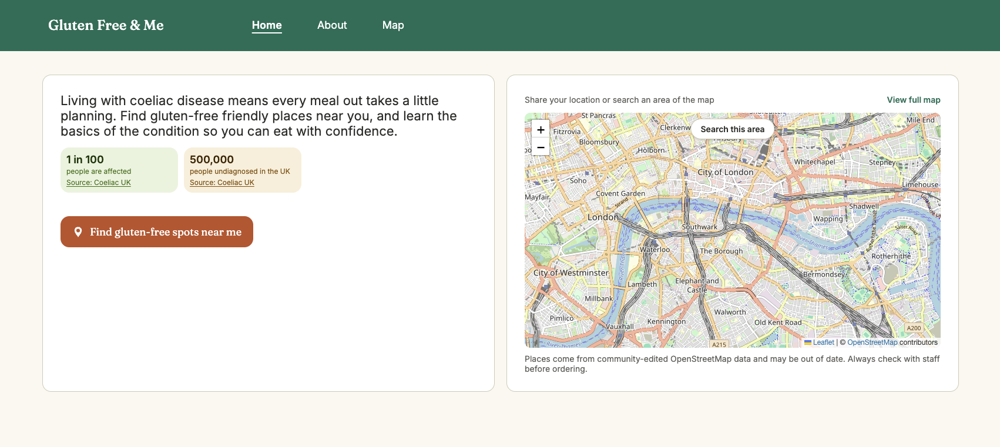

# Gluten Free & Me

**Live site: [coeliac-app-pi.vercel.app](https://coeliac-app-pi.vercel.app)**



A web app for people living with coeliac disease. It finds restaurants, cafes and takeaways near you that offer gluten-free food, and explains the condition in plain English with information from the NHS and Coeliac UK.

## Features

- **Gluten-free places map:** nearby places tagged as gluten-free in OpenStreetMap, colour-coded by whether they're dedicated gluten-free or offer gluten-free options, with a list view sorted by distance.
- **Find near me or search an area:** search around your location, or drag the map and use **Search this area** without sharing your location.
- **Sourced health information:** key facts, symptoms and FAQs, with every answer linked to the NHS, Coeliac UK or GOV.UK.

## Engineering highlights

- **Working with an unreliable free API.** The public Overpass API is rate-limited and often slow, so searches are kept small and only run on request, time out after 20 seconds, retry with backoff only on errors worth retrying, and are cached for 24 hours in the browser so refreshes don't refetch.
- **Accessible by default.** Lighthouse accessibility score of 100 on every page. The map has a keyboard- and screen-reader-friendly list view, and the site has a skip link, a proper heading structure, visible focus rings and WCAG AA contrast.
- **Fast, stable pages.** Lighthouse performance of 99 on content pages (mobile) with zero layout shift. The map library is code-split and lazy-loaded, so pages without a map download a third less JavaScript, and fonts are self-hosted and preloaded.
- **Production setup.** Security headers and a strict Content Security Policy on Vercel, cookieless analytics and real-user performance monitoring with Vercel Web Analytics and Speed Insights, an error boundary, a 404 page that search engines don't index, a privacy notice, and untrusted links from OpenStreetMap data cleaned before use.

More detail is in [docs/technical-notes.md](docs/technical-notes.md).

## Tech stack

- [React 19](https://react.dev) + [TypeScript](https://www.typescriptlang.org), built with [Vite](https://vite.dev)
- [React Router](https://reactrouter.com) for pages
- [vanilla-extract](https://vanilla-extract.style) for type-safe CSS
- [Leaflet](https://leafletjs.com) + [react-leaflet](https://react-leaflet.js.org) for the map, with OpenStreetMap tiles
- [TanStack Query](https://tanstack.com/query) for fetching, caching and persisting place data
- [Overpass API](https://wiki.openstreetmap.org/wiki/Overpass_API) for querying OpenStreetMap
- Hosted on [Vercel](https://vercel.com)

## Running it locally

You'll need Node.js 24 (see `.nvmrc`) and Yarn.

```bash
yarn install
yarn dev
```

In development, the app pretends you're in central London so there are always places on the map. The full list of commands is in the [technical notes](docs/technical-notes.md#commands).

## Project structure

```
src/
├── api/          Calls to external services (Overpass API)
├── components/   Reusable UI components, one folder each with its styles
├── constants/    Shared fixed values (search radius, zoom levels, cache times)
├── context/      Location and search area state
├── data/         Page text, FAQs, sources and privacy notice
├── hooks/        Custom React hooks
├── lib/          TanStack Query setup
├── pages/        One folder per page
├── styles/       Global styles, shared styles and design tokens
├── types/        Shared TypeScript types
└── utils/        Small helper functions with no React dependencies
```

## Data and attribution

- Map tiles and place data © [OpenStreetMap contributors](https://www.openstreetmap.org/copyright), available under the Open Database License.
- Health information is sourced from the [NHS](https://www.nhs.uk/conditions/coeliac-disease/), [Coeliac UK](https://www.coeliac.org.uk/) and [GOV.UK](https://www.gov.uk/understanding-food-labelling/allergen-labelling). The full list is on the app's Sources page.
- The information in the app is general guidance, not medical advice.
